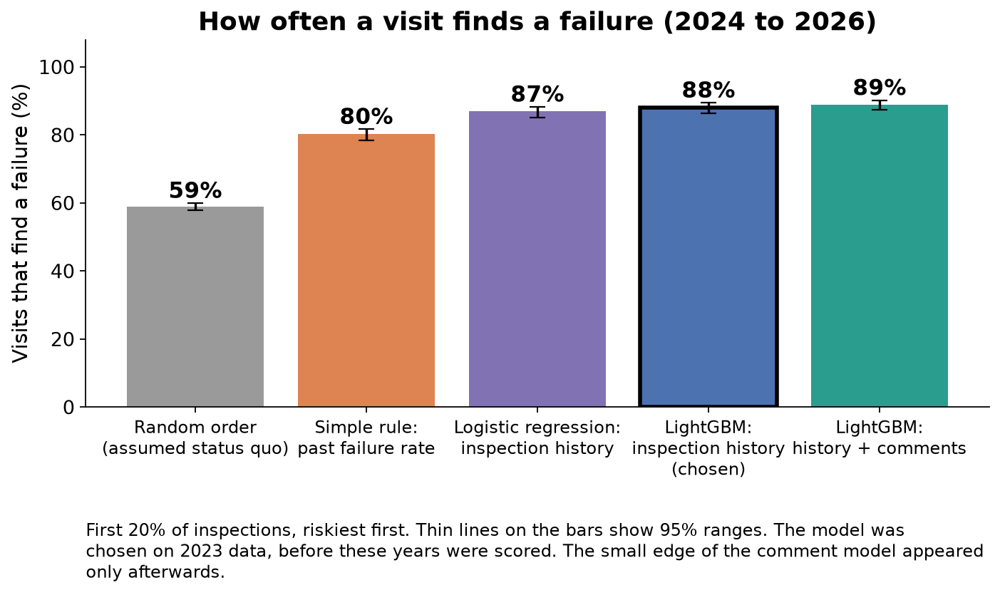
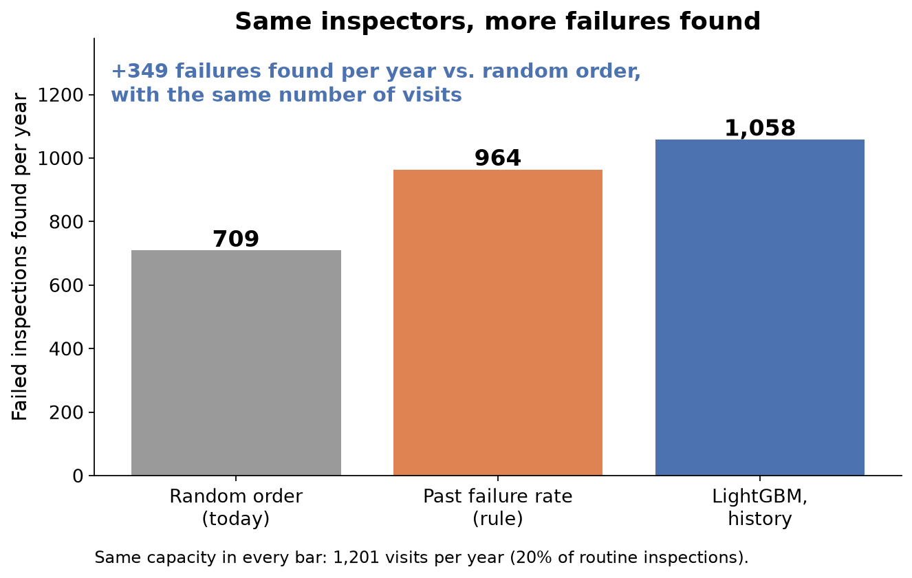
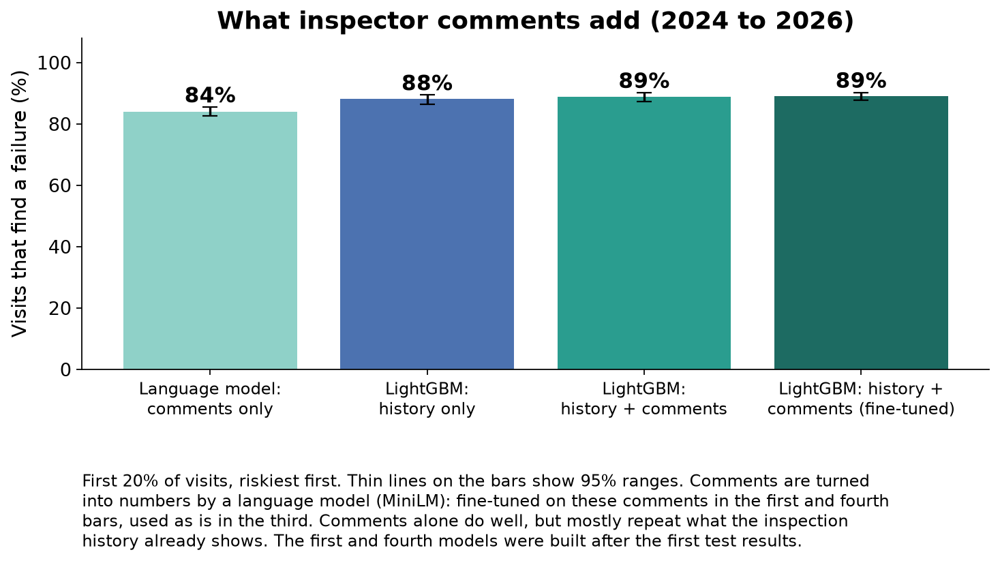
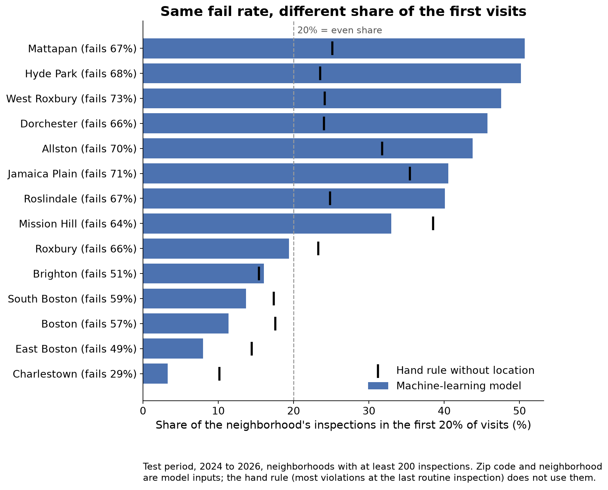

# Results at a glance

A visual summary for readers who want the findings before the code. The [README](README.md) covers the method, the full results table and the steps to reproduce them.

The project ranks Boston's routine restaurant inspections by how likely each one is to fail, so the city can visit the riskiest places first.

## The results in four charts

How often a visit finds a failure, if inspectors make the riskiest 20% of visits first. Random order finds a failure 59% of the time, a simple rule 80%, and the model 88%.

What that means per year: the same 1,201 visits find about 349 more failed inspections than random order.

What the inspector comments add on top of the inspection history: about one point. Comments on their own reach 84%, because they mostly repeat what the history already shows.

A policy question for the city. Zip code is a model input, so neighborhoods with the same fail rate get very different shares of the early visits (Dorchester 46%, Roxbury 19%).

The other charts are in [results/figures](results/figures).

## Where things are

| Folder or file | What it holds | Open it to |
|---|---|---|
| [README.md](README.md) | One-page technical summary: method, results, limitations | Understand or reproduce the method |
| [results/figures](results/figures) | All 10 charts as PNG images | Reuse a chart |
| [results/results.csv](results/results.csv) | The main results table | Check an exact number |
| [results/impact.csv](results/impact.csv) | Impact numbers, each with a line on how it was computed | Check an impact claim |
| [results/README.md](results/README.md) | An index of every results file | Find a specific table |
| [results/priority_list.csv](results/priority_list.csv) | Restaurants ranked by estimated risk | Read [the note](results/priority_list_note.md) first: the scores are estimates, not findings about any business |
| [notebooks](notebooks) | The analysis, step by step (01 data, 02 baselines, 03 models, 04 results, 05 fine-tuning) | See how a number was produced |
| [docs/DECISIONS.md](docs/DECISIONS.md) | Each modeling choice, with the alternatives considered | See why a choice was made |
| [src](src) | The Python code the notebooks call | Read how a step is implemented |

The raw data is not in the repo: the inspector comments contain people's names and emails.

## Terms

| Term | Meaning |
|---|---|
| Hit rate | Share of visits that find a failure |
| First 20% of visits | The riskiest fifth of inspections, visited first. It stands in for limited inspector time |
| Random order | The assumed way inspections are ordered today. The city's actual method could not be confirmed |
| Simple rule | Rank restaurants by how often they failed before. No model needed |
| Validation year (2023) | The year used to choose settings |
| Test years (2024 to 2026) | Years the model never saw while settings were chosen. All headline numbers come from here |
| LightGBM | The machine-learning model chosen: many small decision trees, each correcting the last |
| Embeddings | Comment text turned into numbers by a language model so the main model can use it |
| 95% range | How much a number could move by chance. Bars with overlapping ranges are not clearly different |
