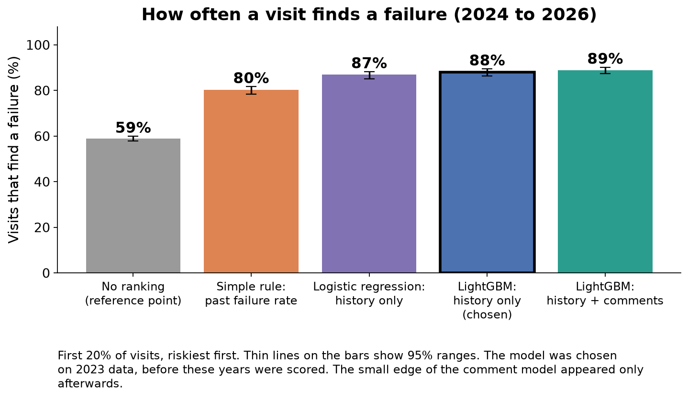
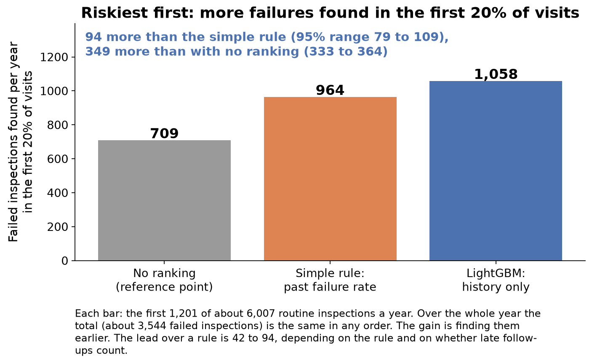
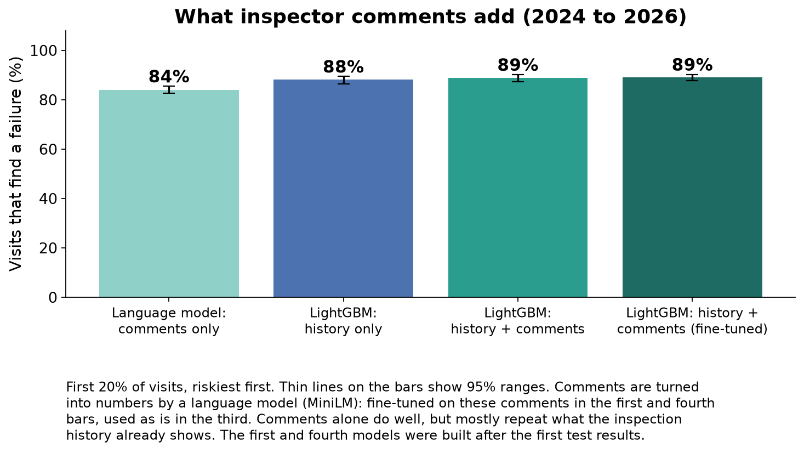
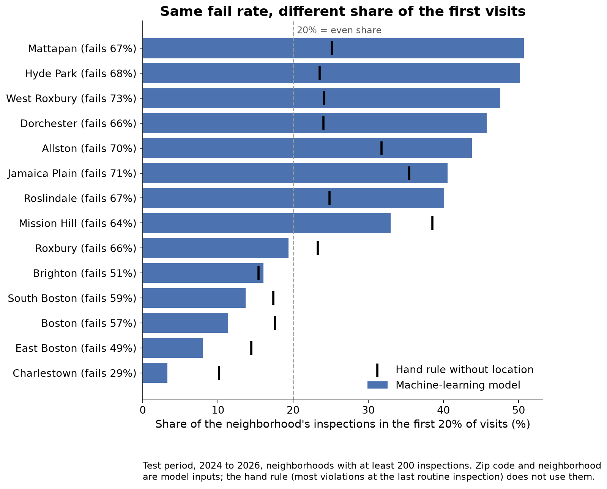
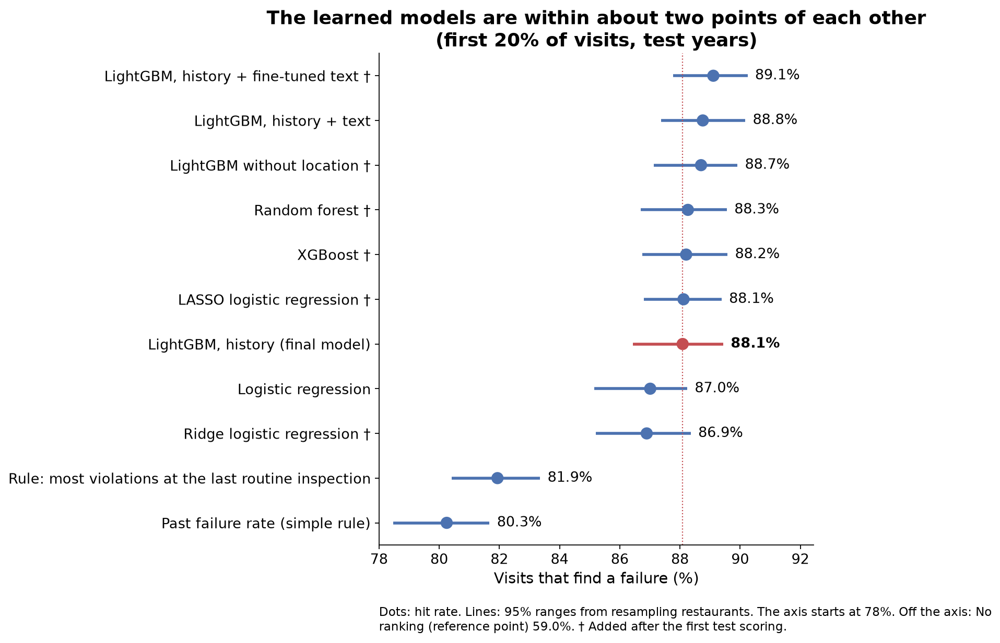

# Results at a glance

A visual summary for readers who want the findings before the code. The [README](README.md) covers the method, the full results table and the steps to reproduce them.

The project ranks Boston's routine restaurant inspections by how likely each one is to fail, so the city can visit the riskiest places first.

## What we recommend

1. Within the city's existing schedule, order visits by inspection history. The city already inspects lower-graded restaurants more often. What the model adds is an order among those visits: a simple rule on past failures finds a failure in 80% of the first visits, and the model in 88%. The model's lead is largest when inspector time is tight: counting only the first 5% of visits, it finds a failure 94% of the time, against 73% for the rule.
2. Leave location out of the model. It does not help the model find failures, and it shifts early visits between neighborhoods (fourth chart). On the test years the model without zip code and neighborhood finds a failure in 88.7% of the first visits, against 88.1% with them, a difference within noise. Dorchester and Roxbury, which fail equally often, then get 35% and 24% of their inspections among the first visits, against 46% and 19%.
3. Consider returning sooner to restaurants that pass but rank high. Among inspections that passed, the 299 the model ranked in its riskiest 20% failed their next routine inspection 60% of the time, against 43% for the others, and the city returned to them only 18 days sooner. The group is small, so the estimate is rough. It shows that the score still carries information after a pass, not that an earlier return would change the outcome.

## The results in four charts

How often a visit finds a failure, if inspectors make the riskiest 20% of visits first. A simple rule on past failures reaches 80%, and the model 88%. The city already inspects lower-graded restaurants more often, so the simple rule is the closer comparison to today, and the model's gain over it is about 8 points. With no ranking at all, the figure would be 59%. That is a reference point, not the city's practice.

What that means per year: in the same 1,201 visits, the model finds 42 to 94 more of the year's 3,544 failed inspections than a simple rule would, and about 349 more than with no ranking. The yearly total does not change, because every restaurant is inspected sooner or later. Ranking finds failures earlier: by 1.1 weeks on average within a quarter, against 0.8 to 0.9 weeks with a simple rule.

What the inspector comments add. Comments alone reach 84%, because they mostly repeat what the history already shows. Added to the history, they gave nothing measurable on 2023 and about one point on 2024 to 2026, a result seen after the settings were frozen. The final model does not use them.

A policy question for the city. Dorchester and Roxbury both fail 66% of the time, yet 46% of Dorchester's inspections land among the first visits and 19% of Roxbury's. About three fifths of that gap comes from zip code and neighborhood, which are model inputs: with location scrambled across inspections, the shares are 35% and 25%, and the hit rate falls by only 0.2 points.

The other charts are in [results/figures](results/figures). One of them shows why earlier matters: the first 20% of visits hold 40% of all serious violations under the model, against 33% to 39% with a simple rule and 20% with no ranking.

Everything on this page except the first two charts, the 349, the lead over logistic regression and the year-by-year hit rates was added after the test years were first scored. It reports on the same frozen predictions and changed no setting. The fine-tuned comment model, the four extra algorithms and the model without location are later models, each scored once with settings frozen beforehand.

## Why this model

LightGBM on the inspection history is the final model. Its settings were fixed on 2023, before the test years were scored, and no other algorithm given the same inputs beats it by more than noise. The chart shows every method we tried. The learned ones sit within about two points of each other, so the choice rests on more than the hit rate at 20%.

| | Logistic regression | LASSO | LightGBM (final) | LightGBM without location | LightGBM + fine-tuned comments |
|---|---|---|---|---|---|
| Hit rate, first 20% of visits | 87.0% | 88.1% | 88.1% | 88.7% | 89.1% |
| Hit rate, first 10% of visits | 90.6% | 90.7% | 92.7% | 93.1% | 93.1% |
| Weeks sooner a failure is found | 1.05 | 1.06 | 1.11 | 1.11 | 1.12 |
| Riskiest tenth: estimated risk, then share that failed | 92%, 91% | 86%, 91% | 93%, 93% | 93%, 93% | 92%, 93% |
| Dorchester and Roxbury inspections among the first visits | 49%, 21% | 38%, 24% | 46%, 19% | 35%, 24% | 45%, 22% |
| What it takes | one formula, 77 weights | one formula, 4 weights that matter | LightGBM, seconds on a laptop | the same, two inputs fewer | a neural network that reads inspector comments |

- The comment model is the most accurate at 20%, by one point. In the first 10% of visits it is within noise of LightGBM, and it finds failures 0.01 weeks sooner. That does not pay for a neural network, a 40-minute fit and reading comments that contain names.
- LASSO is the easiest to explain. Four weights carry its score: violations at the last routine inspection, the share of past routine inspections failed, whether the previous visit failed, and the number of inspections in the last three years. It ties LightGBM at 20% but is 2 points behind in the first 10% of visits, and it underestimates the riskiest restaurants (86% estimated, 91% observed). It is the model to choose if a formula short enough to read matters more than those 2 points.
- LightGBM without location is the version we recommend for use. It is within noise of the final model on every measure, and its first visits follow the fail rate more closely.

## Limits

- The city does not inspect at random. It inspects every restaurant at least once a year and lower-graded ones more often: grade A yearly, B every six months, C every three months ([how the city grades restaurants](https://www.boston.gov/departments/inspectional-services/how-we-grade-restaurants-and-food-trucks), [food service permit](https://www.boston.gov/departments/inspectional-services/how-get-food-service-permit)). "No ranking" is a reference point for what ordering adds, not a description of current practice. The simple rules are the closer comparison, and against them the gain is 42 to 94 failed inspections found early each year, not 349.
- How the city orders visits within a period is not published. In the data, the visits ISD made first in each quarter failed 61.5% of the time, against 59.0% overall, so that order looks close to unranked.
- Some visits are triggered by complaints or illness reports, not scheduled. The data does not say which, so they are counted as routine. They probably fail more often and cannot be rescheduled, which inflates the 59% and the gains by an unknown amount.
- The results rank past visits using what was known on each visit date, including when ISD chose to visit. They measure how good the ranking is. They are not a simulation of a new schedule.
- 20% is an illustrative capacity, and the hit rate fell from 90.1% in 2024 to 84.9% in 2026, so the model would need refitting each year.
- The choice of algorithm adds little: the model leads logistic regression by 1.1 points (95% range 0.3 to 1.9). Four more algorithms given the same inputs (ridge and LASSO logistic regression, random forest, XGBoost) find a failure in 86.9% to 88.3% of the first visits, against the model's 88.1%. Most of the gain comes from the inspection history.
- One input reads backwards. "Previous visit failed" marks a late follow-up, a visit more than 30 days after a failure. Those usually pass, so the model ranks them lower. For the same reason the priority list ranks low the 31 restaurants whose last visit failed more than 30 days ago and that have not been visited since: treat them as overdue follow-ups. Without them, the model's lead over the simple rule falls from 7.8 points to 3.7. Counting each restaurant once, it is 3.3 points (95% range 1.1 to 5.6).
- The 95% ranges resample whole restaurants. They do not account for inspectors covering the same district, so they may be too narrow.
- Scores are estimates, not findings about any business.

## Where things are

| Folder or file | What it holds | Open it to |
|---|---|---|
| [README.md](README.md) | One-page technical summary: method, results, limitations | Understand or reproduce the method |
| [results/figures](results/figures) | All 11 charts as PNG images | Reuse a chart |
| [results/readme_table.csv](results/readme_table.csv) | Every method in one table: hit rate, share of failures found, AUC, serious violations found | Check an exact number |
| [results/comparison_tradeoffs.csv](results/comparison_tradeoffs.csv) | What the choice of model rests on: tighter capacities, timing, calibration, neighborhoods | Check the table above |
| [results/impact.csv](results/impact.csv) | Impact numbers, each with a line on how it was computed | Check an impact claim |
| [results/README.md](results/README.md) | An index of every results file | Find a specific table |
| [results/priority_list.csv](results/priority_list.csv) | Active restaurants, by license number, ranked by estimated risk | Read [the note](results/priority_list_note.md) first: the scores are estimates, not findings about any business |
| [notebooks](notebooks) | The analysis, step by step (01 data, 02 baselines, 03 models, 04 results, and the optional 05 fine-tuning and 06 model comparison) | See how a number was produced |
| [docs/DECISIONS.md](docs/DECISIONS.md) | Each modeling choice, with the alternatives considered | See why a choice was made |
| [docs/setup.md](docs/setup.md) | Setup and reproduction notes | Reproduce our exact files, or run on other hardware |
| [docs/data_dictionary.md](docs/data_dictionary.md) | Every column in the data and every model input | Check what a field or an input means |
| [docs/FROZEN_CONFIG.json](docs/FROZEN_CONFIG.json) | The settings locked before the test years were scored | Check what was fixed in advance |
| [preds](preds) | One risk score per inspection for each model (`_val` is 2023, `_test` is 2024 onward) | Recompute a metric yourself |
| [src](src) | The Python code the notebooks call | Read how a step is implemented |

The raw data is not in the repo: the inspector comments contain people's names and emails.

## Terms

| Term | Meaning |
|---|---|
| Failure | An inspection result that requires a follow-up visit. A pass can still list violations |
| Hit rate | Share of visits that find a failure |
| First 20% of visits | The riskiest fifth of inspections, visited first. It stands in for limited inspector time |
| No ranking | A reference point: visits made in an order that ignores risk. It is not the city's current practice, which already inspects lower-graded restaurants more often |
| Simple rule | Rank restaurants by how often they failed before. A second rule ranks them by the number of violations at their last routine inspection. No model needed |
| Validation year (2023) | The year used to choose settings |
| Test years (2024 to 2026) | Years the model never saw while settings were chosen. All headline numbers come from here |
| LightGBM | The machine-learning model chosen: many small decision trees, each correcting the last |
| Embeddings | Comment text turned into numbers by a language model so the main model can use it |
| 95% range | How much a number could move by chance. Bars with overlapping ranges are not clearly different |
